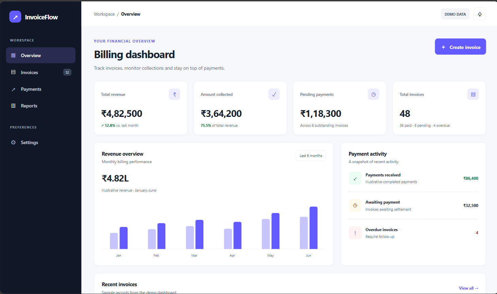
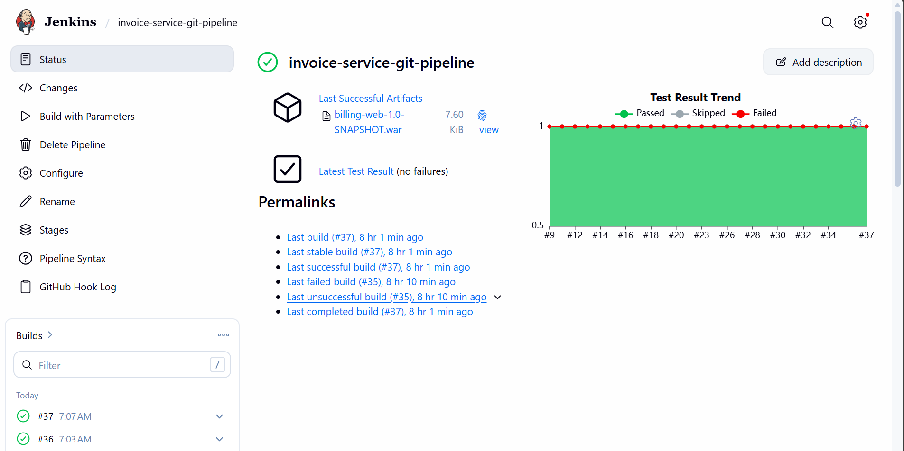
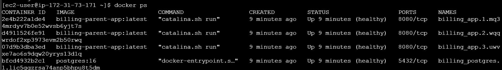

# Invoice Service — CI/CD & Containerized Deployment

An end-to-end DevOps project that automates the build, testing, containerization, and deployment of a Java Maven billing application.

## Tech Stack

- **Build:** Java 21, Maven
- **CI/CD:** Jenkins, GitHub Webhooks
- **Containers:** Docker, Docker Compose, Docker Swarm
- **Registry:** Docker Hub
- **Infrastructure:** AWS EC2
- **Application Server:** Apache Tomcat

## CI/CD Pipeline

1. GitHub webhook triggers the Jenkins pipeline.
2. Jenkins checks out the source code.
3. Maven builds the application and runs verification tests.
4. Docker builds a multi-stage image.
5. The image is pushed to Docker Hub with a build-number tag.
6. Jenkins archives the WAR artifact and deploys the application to Tomcat.
7. A verification stage checks the deployed application.

## Docker & Deployment

- Multi-stage Docker build to reduce image size.
- Non-root container user.
- Container health check.
- Docker Compose configuration for the application and PostgreSQL.
- Docker Swarm stack deployment practice.

## What I Learned

- Automating builds and deployments with Jenkins.
- Integrating GitHub webhooks with CI/CD.
- Building and publishing Docker images.
- Deploying Java WAR applications to Tomcat.
- Container networking, persistent volumes, health checks, and orchestration.

## Run Locally

Requirements: Docker and Docker Compose.

Review `compose.yaml` and the required environment variables before starting:

```bash
docker compose up -d --build
```

Stop the services:

```bash
docker compose down
```

Database data may persist in the named volume after stopping the stack.

## Security Notes

- Secrets and environment-specific configuration should not be committed.
- Configure credentials through Jenkins Credentials and local environment variables.
- Restrict access to cloud instances and exposed ports.

## Application Preview


## CI/CD Pipeline


## Docker Swarm Deployment

---

*Educational DevOps project built to practise CI/CD, containerization, and deployment automation.*